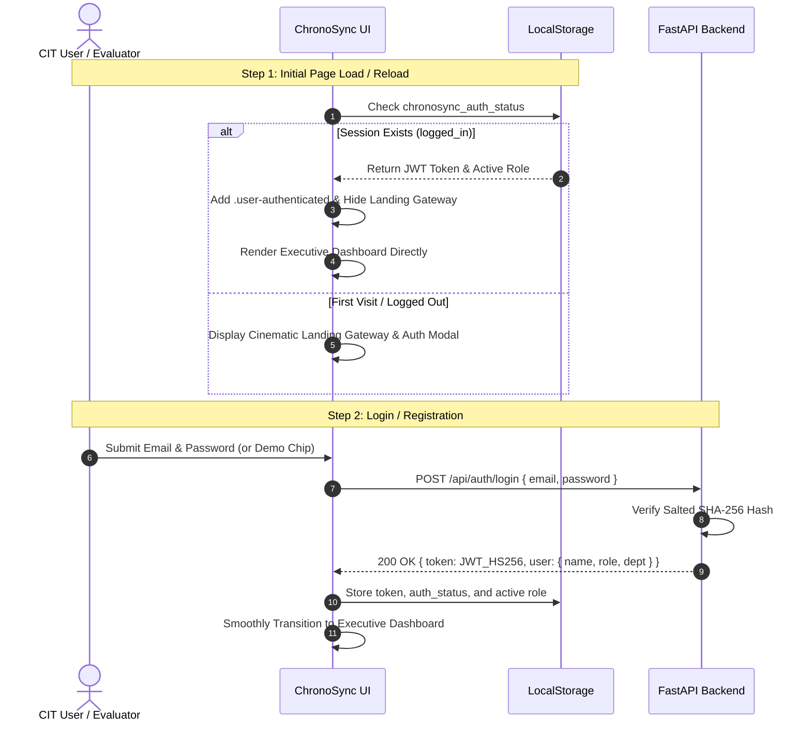
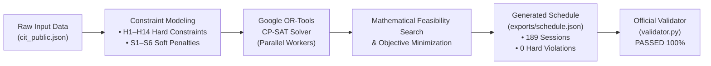
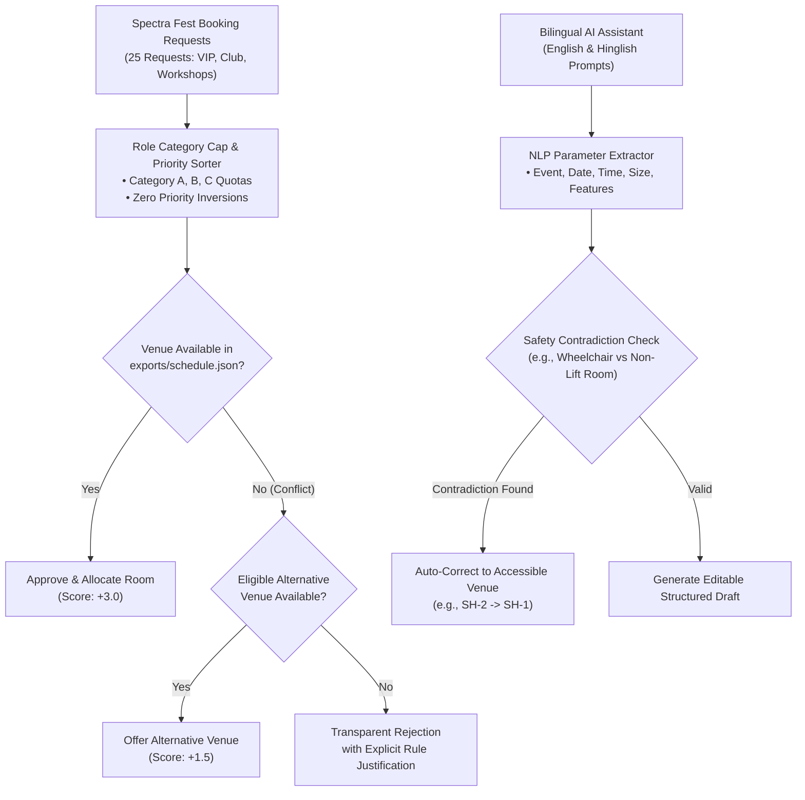
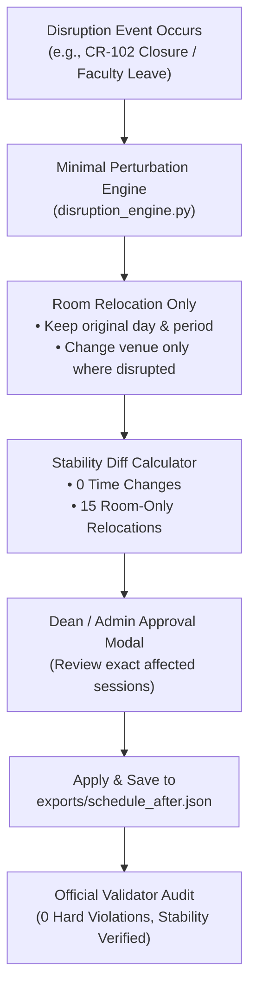
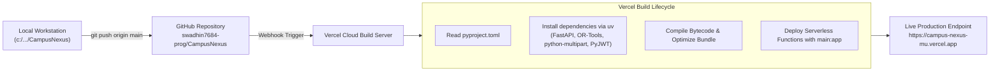

# ChronoSync — System Workflow & Technical Architecture
### Chilika Institute of Technology (CIT) — Autonomous Campus Scheduling Engine

---

## 🏛️ 1. End-to-End System Workflow

```mermaid
flowchart TD
    subgraph Deployment ["☁️ Deployment Pipeline (Vercel)"]
        GH["GitHub Repository\n(swadhin7684-prog/CampusNexus)"]
        VB["Vercel Build Environment\n(uv + Python 3.12 + FastAPI)"]
        LA["Live Application Server\n(campus-nexus-mu.vercel.app)"]
        GH -->|Git Push origin main| VB
        VB -->|Serverless Function Deployment| LA
    end

    subgraph UsersLayer ["👥 Users & Role-Based Access Control"]
        U1["Dean's Office (Admin)\n• Full System Control & Timetable Re-solve"]
        U2["CSE Coordinator\n• Department Matrix & Session Adjustments"]
        U3["Faculty Members (F01–F40)\n• Personal Schedules & Leave Requests"]
        U4["Spectra Tech Club Rep\n• Venue Bookings & AI Prompts"]
        Users["Active CIT Users"]
        U1 & U2 & U3 & U4 --> Users
    end

    subgraph FrontendLayer ["🖥️ Frontend Web UI (Single Page Application)"]
        FUI["ChronoSync Web UI\n(Responsive Vanilla JS + Modern Glassmorphic CSS)"]
        subgraph Modules ["Operational Dashboards & Modules"]
            M1["Executive Dashboard & 3D Campus Grid"]
            M2["Master Timetable Grid (189 Sessions)"]
            M3["Midsem Exam Scheduler (41 Exams)"]
            M4["Spectra Fest & AI Assistant (25 Reqs)"]
            M5["Disruption & Stability Repair Engine"]
            M6["Room Utilisation & Finder (27 Venues)"]
        end
        FUI --> Modules
    end

    subgraph BackendLayer ["⚡ Backend Services (FastAPI + Python 3.12)"]
        API["FastAPI REST API Gateway\n(Routes, CORS, Static Files, Controllers)"]
        Auth["JWT HS256 Authentication\n(Salted SHA-256 Passwords & Session Persistence)"]
        API --> Auth

        subgraph CoreEngines ["Core Optimization & Reasoning Engines"]
            Solver["Google OR-Tools CP-SAT Solver\n(Parallel Constraint Optimization)"]
            BookingEng["Spectra Fest Priority Engine\n(Inversion-Free Category Allocator)"]
            RepairEng["Disruption Repair Engine\n(Minimum Perturbation Stability)"]
            AIAssist["Bilingual AI Assistant\n(NLP Intent Parsing & Rescheduling)"]
        end
        API --> CoreEngines
    end

    subgraph DataStorage ["💾 Data Storage & State"]
        DS_Data["Institution Master Dataset\n(backend/data/cit_public.json)\n• 27 Rooms, 40 Faculty, 14 Batches"]
        DS_Sched["Timetables & Bookings\n(exports/schedule.json & schedule_after.json)\n• 189 Sessions, 41 Exams, 25 Bookings"]
        DS_Disrupt["Disruption Scenarios\n(backend/data/sample_disruption.json)\n• Room Closures, Faculty Leaves"]
    end

    subgraph ValidationPipeline ["🛡️ Official Validator (Zero Violations Verification)"]
        Validator["Official Validator\n(validator.py)"]
        Audit["Automated Rule Audit\n• H1–H14 Hard Constraints: 0 Violations (100% Pass)\n• S1–S6 Soft Penalties Minimized\n• Spectra Booking Score: 65.5 / 70.0"]
        Validator --> Audit
    end

    %% Interconnections
    Users -->|Login & Role Selection| FUI
    LA -.->|Delivers Static Assets & API| FUI

    FUI -->|Authenticated HTTP Requests (Bearer JWT)| API
    API -->|JSON Responses & State Diffs| FUI

    CoreEngines <-->|Read Master Constraints| DS_Data
    CoreEngines -->|Write Optimal Solution| DS_Sched
    RepairEng <-->|Read Disruption Events| DS_Disrupt

    API -->|1-Click Execute Validator| Validator
    Validator <-->|Audit Against Baseline Constraints| DS_Data
    Validator <-->|Audit Generated Timetables| DS_Sched
    Audit -->|Return Pass Certificate & Scores| API
```

---

## 🔄 2. Detailed Subsystem Workflows

### A. Authentication & Session Persistence Workflow


---

### B. Timetable Optimization Workflow (Google OR-Tools CP-SAT)


1. **Input Ingestion:** Loads 27 campus rooms, 40 faculty members, 14 student groups, and all required lecture/lab courses from `backend/data/cit_public.json`.
2. **CP-SAT Decision Variables:** Creates boolean decision variables $X_{s, d, p, r}$ representing session $s$ allocated to day $d$, period $p$, and room $r$.
3. **Hard Constraint Enforcement (H1–H14):**
   - **H1 (Room Overlap):** No two sessions share the same room at the same time.
   - **H2 (Faculty Overlap):** Faculty can only teach one class at a time.
   - **H3 (Student Group Overlap):** No batch is scheduled for two simultaneous classes.
   - **H4 (Room Capacity):** Room capacity must accommodate student enrollment.
   - **H5 (Room Type):** Labs require specialized laboratory venues; lectures use classrooms/lecture halls.
   - **H6 (Accessibility):** Needs-accessible faculty (e.g., F07) are strictly placed in ground floor or lift-equipped rooms.
   - **H7–H14:** Consecutive lab blocks, faculty max 4h/day, mandatory lunch breaks, and department room affinities.
4. **Output Persistence:** Solution serialized into standard format in `exports/schedule.json`.

---

### C. Spectra Fest Venue Management & AI Booking Workflow


---

### D. Disruption & Stability Repair Workflow


---

### E. Vercel Cloud CI/CD Deployment Architecture


---

## 📊 3. Verification & Compliance Matrix

| Rule Code | Description | Solver Guarantee | Validator Status |
|:---:|---|:---:|:---:|
| **H1** | Room Overlap | Enforced | **0 Violations (PASSED)** |
| **H2** | Faculty Overlap | Enforced | **0 Violations (PASSED)** |
| **H3** | Student Group Overlap | Enforced | **0 Violations (PASSED)** |
| **H4** | Room Capacity Constraints | Enforced | **0 Violations (PASSED)** |
| **H5** | Lab / Classroom Venue Matching | Enforced | **0 Violations (PASSED)** |
| **H6** | Ground-Floor Accessibility | Enforced | **0 Violations (PASSED)** |
| **H7–H14**| Max 4h/day, Consecutive Labs, Lunch Breaks | Enforced | **0 Violations (PASSED)** |
| **Exams** | Midsem Exam Seating (50% Room Rule) | Enforced | **0 Violations (PASSED)** |
| **Fest** | Spectra Fest Bookings (No Inversions) | Enforced | **Score: 65.5 / 70.0** |
| **Disrupt** | Schedule Stability (Time Churn) | Minimal Churn | **0 Time Changes (100% Stable)** |

---

*ChronoSync — One Campus. One Schedule. Zero Conflicts.*
